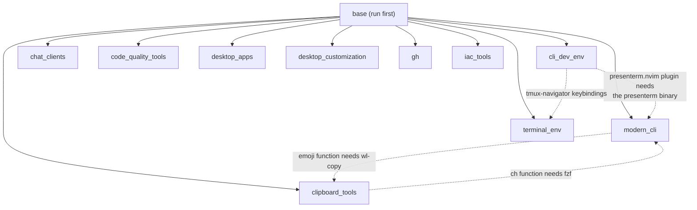

# infra-ansible-collection-workstation

An Ansible Collection (`swisstopo.workstation`) for provisioning and maintaining
IaC developer workstations running Ubuntu 24.04 with the COSMIC or GNOME desktop
environment.

## Roles

No role declares an Ansible role dependency on another (`meta/main.yml` is
empty everywhere), so every role can run standalone — this is what Molecule
tests. On a real workstation, run `base` first anyway: it sets up locale,
proxy, hostname, git, and fonts that other roles are written to assume are
already in place.

| Role | What it installs |
| --- | --- |
| [base](roles/base/README.md) | Base system packages, hostname, locale, corporate proxy, git, SSH, Python toolchain, fonts — run first |
| [cli_dev_env](roles/cli_dev_env/README.md) | lazygit, neovim (LazyVim), Claude Code CLI |
| [chat_clients](roles/chat_clients/README.md) | Slack, Microsoft Teams |
| [clipboard_tools](roles/clipboard_tools/README.md) | Wayland clipboard tooling: wl-clipboard, cliphist, clipse |
| [code_quality_tools](roles/code_quality_tools/README.md) | trivy, pre-commit, detect-secrets, yamllint, checkov, ansible-lint |
| [desktop_apps](roles/desktop_apps/README.md) | OnlyOffice Desktop Editors, Firefox policies |
| [desktop_customization](roles/desktop_customization/README.md) | GNOME/COSMIC workspace settings, Flameshot, emoji picker (GUI) |
| [gh](roles/gh/README.md) | GitHub CLI |
| [iac_tools](roles/iac_tools/README.md) | ansible-core, Docker CE, AWS CLI, Terraform/Vault, Kubernetes toolchain |
| [modern_cli](roles/modern_cli/README.md) | bat, btop, eza, fd, fzf, htop, presenterm, ripgrep, zoxide, emoji-fzf |
| [terminal_env](roles/terminal_env/README.md) | zsh, tmux, kitty |

Solid arrows are hard "must run first" dependencies; dotted arrows are soft
couplings documented in the linked roles' own READMEs (shell functions or
plugin configs that degrade gracefully if the other role isn't installed).

Every role uses per-tool Ansible tags (in addition to an umbrella
`<role_name>` tag) so a consuming playbook can select a single tool with
`--tags <tool>` — see each role's own README for its tag table.

## Continuous Integration

Lint (`ci.yml`) and release (`release-please.yml`) both run as thin wrappers around
reusable workflows in [infra-github-shared-actions](https://github.com/swisstopo/infra-github-shared-actions),
so tooling versions and behavior stay in sync with the other Ansible collections
(e.g. `infra-ansible-collection-postgres`). Release-please authenticates as a GitHub
App (org secrets `RELEASE_BOT_APP_ID` / `RELEASE_BOT_PRIVATE_KEY`) so release PRs are
not blocked by the org policy on `github-actions[bot]`.
