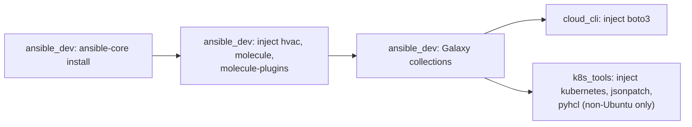

# pmuellerch.workstation.ansible_dev

Installs the tooling for developing and testing Ansible: `ansible-core` (pipx) with molecule and the common Galaxy
collections, Docker CE, and `act` (run GitHub Actions workflows locally). Split out of the former `iac_tools` role.

## What it does

1. **ansible** — bootstraps a pipx new enough for `community.general.pipx`, installs `ansible-core` via pipx, injects
   `hvac`, `molecule` and `molecule-plugins[docker]` into its venv, and installs the Galaxy collections from
   `files/requirements.yml`.
2. **docker** — installs Docker CE from its official apt repository, adds the user to the `docker` group and, when a
   proxy is configured, deploys the daemon (systemd drop-in) and client (`~/.docker/config.json`) proxy settings.
3. **act** — installs `act` from a checksum-verified GitHub release tar.gz. It runs a workflow job locally via Docker
   rather than just linting it (see `code_quality_tools`' `actionlint` for the linting half).

## Variables

### Defaults (`defaults/main.yml`)

| Variable | Default | Description |
| --- | --- | --- |
| `ansible_dev_ansible_enabled` | `true` | Install ansible-core, molecule and Galaxy collections |
| `ansible_dev_docker_enabled` | `true` | Install Docker CE |
| `ansible_dev_act_enabled` | `true` | Install act (needs a working Docker daemon to actually run anything) |
| `ansible_dev_http_proxy` | `""` | Corporate HTTP proxy URL for the Docker daemon/client. Leave empty on machines without a proxy |
| `ansible_dev_https_proxy` | `ansible_dev_http_proxy` | Corporate HTTPS proxy URL |
| `ansible_dev_no_proxy` | `""` | Comma-separated proxy bypass list |
| `ansible_dev_pipx_min_version` | see `defaults/main.yml` | pipx version bootstrapped via `pip install --user` (Renovate-managed) |
| `ansible_dev_ansible_core_version` | see `defaults/main.yml` | ansible-core (pypi), held on the 2.21.x line (Renovate-managed) |
| `ansible_dev_molecule_version` | see `defaults/main.yml` | molecule (pypi), injected into the ansible-core venv (Renovate-managed) |
| `ansible_dev_molecule_plugins_version` | see `defaults/main.yml` | molecule-plugins[docker] (pypi), injected (Renovate-managed) |
| `ansible_dev_hvac_version` | see `defaults/main.yml` | hvac (pypi), injected into the ansible-core venv (Renovate-managed) |
| `ansible_dev_act_version` | see `defaults/main.yml` | act (github-releases: `nektos/act`, Renovate-managed) |
| `ansible_dev_act_download_base` | see `defaults/main.yml` | Base URL the act archive and `checksums.txt` are downloaded from |

## Usage examples

```yaml
- hosts: localhost
  roles:
    - role: pmuellerch.workstation.ansible_dev
      vars:
        ansible_dev_http_proxy: "http://proxy.example.com:8080"
        ansible_dev_no_proxy: "localhost,127.0.0.1"
```

| Component | Tags |
| --- | --- |
| pipx bootstrap, ansible-core, molecule, Galaxy collections | `ansible`, `ansible_dev` |
| Docker CE | `docker`, `ansible_dev` |
| act | `act`, `ansible_dev` |

**Do not** put an outer `tags:` on the role invocation in your play — it cascades to every task and defeats the
per-component filtering.

## Notes

### The shared ansible-core pipx venv

This role owns the `ansible-core` pipx venv. Other roles inject packages into the same venv, but only if it already
exists:



**Run `ansible_dev` before `cloud_cli` and `k8s_tools`** (in that order in your play). If the venv doesn't exist yet,
those roles skip their inject instead of failing; a second run then wires it up. `hvac` is injected only here —
`k8s_tools` does not inject its own copy, so there is a single pinned version in the venv.

### pipx bootstrap

`community.general.pipx` hard-requires pipx **>= 1.7.0**, but Ubuntu 24.04's apt-provided `pipx` is only **1.4.3**.
Per role independence, this role can't assume the consumer upgraded pipx globally, so it bootstraps one itself — same
pattern as `code_quality_tools` (`pip3 install --user pipx==<version> --break-system-packages`, which shadows the apt
pipx on `sys.path` without any `PATH` manipulation).

Because that `pip3 install --user` step reports `changed` under `--check` without installing anything, every
pipx-based task downstream of it (the `ansible-core` install and every inject) is gated with
`when: not ansible_check_mode`.

### Other notes

- The Galaxy requirements file is staged in a private temporary directory (mode 0700, removed afterwards) rather than a
  fixed `/tmp` path, and installed with `ansible-galaxy collection install --upgrade` so Renovate bumps of
  `files/requirements.yml` actually apply on an already-provisioned machine.
- `act` is checksum-verified against upstream's own aggregate `checksums.txt` and extracted straight to
  `/usr/local/bin/act`. The download is staged in a private per-run directory (mode 0700,
  removed afterwards, also on failure) and verified at download time, so no other local user can swap it before the
  root-level extraction.
- Docker's apt signing key is fetched over TLS from `download.docker.com` (re-fetched on every run, so rotations are picked up) and apt then verifies
  every package against the signed repository metadata.
- Docker client proxy config is deployed with `force: false`, so `docker login` credentials and manual edits survive
  re-runs.
- The Docker apt repository, packages and group membership are skipped under `--check` (the `docker` group is created
  by docker-ce's postinst, which never ran).

## Testing

```bash
cd roles/ansible_dev && molecule test
```

## Platforms

| OS | Tested |
| --- | --- |
| Ubuntu 24.04 | yes |
