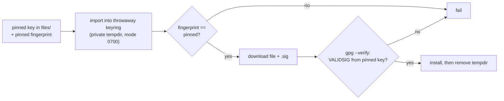

# pmuellerch.workstation.cloud_cli

Installs the CLI tooling for working with cloud infrastructure: AWS CLI v2 with `session-manager-plugin`, Terraform
and Vault with `tfswitch`/`tflint`/`terraform-docs`, and `floci` (a local AWS emulator). Split out of the former
`iac_tools` role.

## What it does

1. **aws** — installs AWS CLI v2 and `session-manager-plugin` (both GPG-signature-verified, see below), deploys an `asl`
   alias and the proxy environment snippet, renders `~/.aws/config` from `cloud_cli_aws_profiles`, and injects `boto3`
   into the `ansible-core` pipx venv when the `ansible_dev` role created it.
2. **terraform** — installs Terraform and Vault from the HashiCorp apt repository, plus `tfswitch`, `tflint` and
   `terraform-docs` from checksum-verified GitHub releases; deploys `terraformrc` (plugin cache, optional Terraform
   Cloud token), Terraform aliases, an optional proxy snippet and, when `cloud_cli_vault_addr` is set, the Vault shell
   integration (`vault-login`).
3. **floci** — installs the `floci` CLI from a checksum-verified GitHub release binary.

## Variables

### Defaults (`defaults/main.yml`)

| Variable | Default | Description |
| --- | --- | --- |
| `cloud_cli_aws_enabled` | `true` | Install AWS CLI v2, session-manager-plugin, boto3 inject, AWS config |
| `cloud_cli_terraform_enabled` | `true` | Install Terraform, Vault, tfswitch, tflint, terraform-docs |
| `cloud_cli_floci_enabled` | `true` | Install the floci CLI |
| `cloud_cli_http_proxy` | `""` | Only toggles the AWS/Terraform proxy shell snippets. Leave empty on machines without a proxy |
| `cloud_cli_vault_addr` | `""` | HashiCorp Vault server address. Leave empty to skip Vault shell integration |
| `cloud_cli_aws_cli_version` | see `defaults/main.yml` | AWS CLI v2 (github-tags: `aws/aws-cli`, Renovate-managed) |
| `cloud_cli_aws_boto3_version` | see `defaults/main.yml` | boto3 (pypi), injected into the ansible-core venv (Renovate-managed) |
| `cloud_cli_aws_session_manager_plugin_version` | see `defaults/main.yml` | session-manager-plugin (github-releases, Renovate-managed) |
| `cloud_cli_aws_cli_key_fingerprint` | see `defaults/main.yml` | Pinned fingerprint of the AWS CLI signing key in `files/aws-cli-team.asc` |
| `cloud_cli_aws_session_manager_plugin_key_fingerprint` | see `defaults/main.yml` | Pinned fingerprint of the key in `files/session-manager-plugin-signer.asc` |
| `cloud_cli_aws_profiles` | `[]` | AWS SSO profiles rendered into `~/.aws/config` — see below |
| `cloud_cli_tflint_version` | see `defaults/main.yml` | tflint (github-releases, Renovate-managed) |
| `cloud_cli_terraform_docs_version` | see `defaults/main.yml` | terraform-docs (github-releases, Renovate-managed) |
| `cloud_cli_terraform_docs_download_base` | see `defaults/main.yml` | Base URL for the terraform-docs archive and its sha256sum file |
| `cloud_cli_terraform_docs_archive` | see `defaults/main.yml` | Filename of the terraform-docs release archive |
| `cloud_cli_tfswitch_version` | see `defaults/main.yml` | tfswitch (github-releases: `warrensbox/terraform-switcher`, Renovate-managed) |
| `cloud_cli_tfswitch_archive` | see `defaults/main.yml` | Filename of the tfswitch release archive |
| `cloud_cli_tfswitch_download_base` | see `defaults/main.yml` | Base URL for the tfswitch archive and its checksums file |
| `cloud_cli_floci_version` | see `defaults/main.yml` | floci CLI (github-releases: `floci-io/floci-cli`, Renovate-managed) |
| `cloud_cli_terraform_cloud_token` | `""` | Terraform Cloud API token from the consumer's own secret store |
| `cloud_cli_terraform_vault_github_token` | `""` | GitHub PAT for `vault login --method=github`, from the consumer's own secret store |

## Usage examples

```yaml
- hosts: localhost
  roles:
    - role: pmuellerch.workstation.cloud_cli
      vars:
        cloud_cli_vault_addr: "https://vault.example.com:8200"
        cloud_cli_aws_profiles:
          - name: default
            sso_start_url: "https://example.awsapps.com/start#/"
            sso_region: eu-central-1
            output: json
```

| Component | Tags |
| --- | --- |
| AWS CLI, session-manager-plugin, boto3 inject, AWS config | `aws`, `cloud_cli` |
| Terraform, Vault, tfswitch, tflint, terraform-docs | `terraform`, `cloud_cli` |
| floci | `floci`, `cloud_cli` |

**Do not** put an outer `tags:` on the role invocation in your play — it cascades to every task and defeats the per-component
filtering.

### `cloud_cli_aws_profiles` → `~/.aws/config`

The list drives a Jinja2 template, since a shared collection can't ship organization-specific data (SSO account IDs)
as fixed content. **When the list is empty, `~/.aws/config` is not deployed at all** rather than writing an empty
or broken file.

```yaml
cloud_cli_aws_profiles:
  - name: default # renders a bare [default] block
    sso_start_url: "https://example.awsapps.com/start#/"
    sso_region: eu-central-1
    output: json
  - name: example-master # renders [profile example-master]
    sso_start_url: "https://example.awsapps.com/start#/"
    sso_role_name: AdministratorAccess
    sso_account_id: "111111111111"
    sso_region: eu-central-1
    region: eu-central-1
    output: json
```

`sso_role_name`, `sso_account_id` and `region` are optional per entry.

## Notes

### Signature verification (AWS CLI, session-manager-plugin)

AWS publishes only a detached GPG `.sig` for the AWS CLI installer and the session-manager-plugin `.deb` — no plain or
structured checksum file. Both are therefore verified before anything is installed (the `.deb` is installed as root):



- The vendor keys are shipped in `files/` (`aws-cli-team.asc`, copied from the AWS CLI install guide;
  `session-manager-plugin-signer.asc`, the key AWS signs the plugin with) and each is pinned by its full
  primary-key fingerprint in `defaults/main.yml`. A swapped key file fails the fingerprint assertion.
- Downloads, the throwaway GnuPG home and the extracted installer all live in one `ansible.builtin.tempfile` directory
  that is removed afterwards (also on failure) — no fixed, guessable `/tmp` path.
- **Key rotation**: the AWS CLI team key expires on **2027-07-01**. When AWS rotates it, verification fails with a clear
  message; replace `files/aws-cli-team.asc` with the key from the
  [AWS CLI install guide](https://docs.aws.amazon.com/cli/latest/userguide/getting-started-install.html) and update
  `cloud_cli_aws_cli_key_fingerprint`. Same procedure for the Session Manager plugin key
  (see the AWS Systems Manager docs, "Verify the signature of the Session Manager plugin package").
- Skipped under `--check` (`ansible.builtin.tempfile` doesn't run there).

### Other notes

- **Terraform and Vault** come from the HashiCorp apt repository (`signed_by` a keyring fetched over TLS from
  `apt.releases.hashicorp.com`, re-fetched on every run), no key-fingerprint pin yet; apt validates package integrity against the signed `Release`
  metadata, so no per-package checksum is needed.
- `tflint`, `terraform-docs` and `tfswitch` are downloaded from pinned GitHub releases and checksum-verified against
  upstream's own per-release checksum files (`get_url` matches the entry by file name, so there's no static hash to
  keep in sync when Renovate bumps a version). Downloads are staged in a private per-run
  directory (mode 0700, removed afterwards, also on failure) and verified at download time.
- `floci` uses a fetch-and-parse checksum (its `sha256sums.txt` lists directory-style paths `get_url` can't match
  directly).
- `terraformrc` (which may contain the Terraform Cloud token) is deployed with `no_log: true`; the Vault GitHub token
  file is deployed mode 0600 with `no_log: true`; `vault-login` passes the token via `token=@file` so it never
  appears in `ps`.
- `~/.aws/config` is deployed with `force: false` so manual edits survive re-runs.
- **boto3 inject**: requires the `ansible-core` pipx venv from the `ansible_dev` role. If it isn't there yet the inject
  is skipped (not failed); run `ansible_dev` first and re-run this role.

### floci

[floci](https://floci.io) is a free, open-source local AWS emulator (LocalStack-compatible, MIT licensed) listening on
`localhost:4566`, useful for validating Terraform/AWS changes locally before applying via CI. This role only installs
the **CLI** (`floci-io/floci-cli`) to `/usr/local/bin/floci`; `floci start` pulls and manages the emulator engine as a
Docker container itself, so a working Docker daemon (for example from the `ansible_dev` role) is required at runtime.

```bash
floci start                       # pulls/starts the floci/floci Docker container
eval $(floci env)                 # exports AWS_ENDPOINT_URL, AWS_DEFAULT_REGION, test credentials
```

To point a Terraform AWS provider at it, add an `endpoints` block (Terraform's standard mechanism, not floci-specific):

```hcl
provider "aws" {
  region                      = "us-east-1"
  access_key                  = "test" # pragma: allowlist secret
  secret_key                  = "test" # pragma: allowlist secret
  skip_credentials_validation = true
  skip_metadata_api_check     = true
  skip_requesting_account_id  = true

  endpoints {
    s3  = "http://localhost:4566"
    ec2 = "http://localhost:4566"
    # ... one entry per AWS service exercised by the config under test
  }
}
```

## Testing

```bash
cd roles/cloud_cli && molecule test
```

The scenario also applies `ansible_dev` (ansible component only) first, to cover the boto3 inject.

## Platforms

| OS | Tested |
| --- | --- |
| Ubuntu 24.04 | yes |
