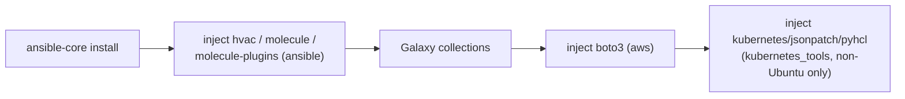

# swisstopo.workstation.iac_tools

Installs infra/cloud CLI tooling a cloud engineer reaches for together:
`ansible-core` (pipx) with Galaxy collections, Docker CE, `act` (run GitHub
Actions workflows locally), AWS CLI v2 + session-manager-plugin, Terraform +
Vault + tfswitch/tflint/terraform-docs, `floci` (local AWS emulator), and a
full Kubernetes toolchain (kubectl, k9s, helm, kubectx/kubens, stern, krew,
kubeconform, kube-linter). Bundled together because they're the same
category of tool for provisioning and operating cloud infrastructure.

## What it does

- **ansible**: installs `ansible-core` via pipx, injects `hvac`/`molecule`/
  `molecule-plugins` into its venv, and installs the collection's own
  requirements (Galaxy collections).
- **docker**: installs Docker CE from its official apt repository.
- **act**: installs `act` from a checksum-verified GitHub release tar.gz —
  runs a workflow job locally via Docker rather than just linting it (see
  `code_quality_tools`' `actionlint` for the linting half).
- **aws**: installs AWS CLI v2 and `session-manager-plugin` from GitHub
  releases, and renders `~/.aws/config` from `iac_tools_aws_profiles`.
- **terraform**: installs Terraform, Vault, tfswitch, tflint, and
  terraform-docs.
- **floci**: installs the `floci` CLI from a checksum-verified GitHub
  release binary — a free, open-source local AWS emulator
  (LocalStack-compatible) for validating Terraform/AWS changes without a
  real AWS account.
- **kubernetes_tools**: installs kubectl, k9s, helm, kubectx/kubens, stern,
  krew, kubeconform, and kube-linter, and renders `~/.kube/config` from
  `iac_tools_kubernetes_clusters`.

## Requirements

| OS | Tested |
| --- | --- |
| Ubuntu 24.04 | yes |

No Ansible role dependency (this role runs standalone in Molecule) — but on
a real workstation, run `base` first, per the root README.

## Role Variables

| Variable | Default | Description |
| --- | --- | --- |
| `iac_tools_ansible_enabled` | `true` | Install ansible-core + Galaxy collections |
| `iac_tools_docker_enabled` | `true` | Install Docker CE |
| `iac_tools_act_enabled` | `true` | Install act (requires a working Docker daemon to actually run anything) |
| `iac_tools_aws_enabled` | `true` | Install AWS CLI v2 + session-manager-plugin |
| `iac_tools_terraform_enabled` | `true` | Install Terraform/Vault/tfswitch/tflint/terraform-docs |
| `iac_tools_kubernetes_tools_enabled` | `true` | Install the Kubernetes toolchain |
| `iac_tools_floci_enabled` | `true` | Install the floci CLI (local AWS emulator) |
| `iac_tools_http_proxy` | `""` | Corporate HTTP proxy URL. Leave empty on machines without a proxy |
| `iac_tools_https_proxy` | `iac_tools_http_proxy` | Corporate HTTPS proxy URL |
| `iac_tools_no_proxy` | `""` | Comma-separated proxy bypass list |
| `iac_tools_vault_addr` | `""` | HashiCorp Vault server address. Leave empty to skip Vault shell integration |
| `iac_tools_pipx_min_version` | see `defaults/main.yml` | pipx version bootstrapped via `pip install --user`, see below |
| `iac_tools_ansible_core_version` | see `defaults/main.yml` | ansible-core version (pypi), via pipx |
| `iac_tools_ansible_molecule_version` | see `defaults/main.yml` | molecule version (pypi), injected into the ansible-core venv |
| `iac_tools_ansible_molecule_plugins_version` | see `defaults/main.yml` | molecule-plugins[docker] version (pypi), injected into the ansible-core venv |
| `iac_tools_hvac_version` | see `defaults/main.yml` | hvac version (pypi), injected into the ansible-core venv by both `ansible` and `kubernetes_tools` |
| `iac_tools_act_version` | see `defaults/main.yml` | act version (github-releases: `nektos/act`) |
| `iac_tools_act_download_base` | see `defaults/main.yml` | Base URL the act archive/checksums.txt are downloaded from |
| `iac_tools_aws_cli_version` | see `defaults/main.yml` | AWS CLI v2 version (github-tags: `aws/aws-cli`) |
| `iac_tools_aws_boto3_version` | see `defaults/main.yml` | boto3 version (pypi), injected into the ansible-core venv |
| `iac_tools_aws_session_manager_plugin_version` | see `defaults/main.yml` | session-manager-plugin version (github-releases: `aws/session-manager-plugin`) |
| `iac_tools_aws_profiles` | `[]` | AWS SSO profiles rendered into `~/.aws/config` — see below |
| `iac_tools_tflint_version` | see `defaults/main.yml` | tflint binary version (github-releases) |
| `iac_tools_terraform_docs_version` | see `defaults/main.yml` | terraform-docs binary version (github-releases) |
| `iac_tools_terraform_docs_archive` | see `defaults/main.yml` | Filename of the terraform-docs release archive |
| `iac_tools_tfswitch_version` | see `defaults/main.yml` | tfswitch binary version (github-releases: `warrensbox/terraform-switcher`), checksum-verified |
| `iac_tools_tfswitch_archive` | see `defaults/main.yml` | Filename of the tfswitch release archive |
| `iac_tools_tfswitch_download_base` | see `defaults/main.yml` | Base URL the tfswitch archive and its `checksums.txt` are downloaded from |
| `iac_tools_floci_version` | see `defaults/main.yml` | floci CLI version (github-releases: `floci-io/floci-cli`), checksum-verified |
| `iac_tools_terraform_cloud_token` | `""` | Terraform Cloud API token from the consumer's own secret store |
| `iac_tools_terraform_vault_github_token` | `""` | GitHub PAT for `vault login --method=github`, from the consumer's own secret store |
| `iac_tools_kubectl_version` | see `defaults/main.yml` | kubectl version (github-releases: `kubernetes/kubernetes`), checksum-verified |
| `iac_tools_kubectl_url` | see `defaults/main.yml` | Download URL for the pinned kubectl binary |
| `iac_tools_kubectl_checksum_url` | see `defaults/main.yml` | URL of kubectl's published `.sha256` checksum file |
| `iac_tools_k9s_version` | see `defaults/main.yml` | k9s version (github-releases) |
| `iac_tools_helm_version` | see `defaults/main.yml` | helm version (github-releases) |
| `iac_tools_kubectx_version` | see `defaults/main.yml` | kubectx/kubens version (github-releases) |
| `iac_tools_kubectx_archive` | see `defaults/main.yml` | Filename of the kubectx release archive |
| `iac_tools_kubens_archive` | see `defaults/main.yml` | Filename of the kubens release archive |
| `iac_tools_stern_version` | see `defaults/main.yml` | stern version (github-releases) |
| `iac_tools_krew_version` | see `defaults/main.yml` | krew version (github-releases) |
| `iac_tools_kubeconform_version` | see `defaults/main.yml` | kubeconform version (github-releases) |
| `iac_tools_kube_linter_version` | see `defaults/main.yml` | kube-linter version (github-releases) |
| `iac_tools_kubernetes_pip_kubernetes_version` | see `defaults/main.yml` | Python `kubernetes` library version (pypi), non-Ubuntu targets only |
| `iac_tools_kubernetes_pip_jsonpatch_version` | see `defaults/main.yml` | Python `jsonpatch` library version (pypi), non-Ubuntu targets only |
| `iac_tools_kubernetes_pip_pyhcl_version` | see `defaults/main.yml` | Python `pyhcl` library version (pypi), non-Ubuntu targets only |
| `iac_tools_kubernetes_clusters` | `[]` | EKS clusters rendered into `~/.kube/config` — see below |
| `iac_tools_kubernetes_current_context` | `""` | kubeconfig `current-context`; defaults to the first cluster entry |

## Example Playbook

```yaml
- hosts: workstations
  roles:
    - role: swisstopo.workstation.iac_tools
      vars:
        iac_tools_vault_addr: "https://vault.example.com:8200"
        iac_tools_aws_profiles:
          - name: default
            sso_start_url: "https://example.awsapps.com/start#/"
            sso_region: eu-central-1
            output: json
```

## Tags

Every task carries its own tag in addition to the umbrella `iac_tools` tag,
so a consuming playbook can filter to a single sub-role:

| Sub-role | Tag |
| --- | --- |
| ansible-core, Galaxy collections | `ansible`, `iac_tools` |
| Docker CE | `docker`, `iac_tools` |
| act | `act`, `iac_tools` |
| AWS CLI, session-manager-plugin | `aws`, `iac_tools` |
| Terraform, Vault, tfswitch, tflint, terraform-docs | `terraform`, `iac_tools` |
| floci | `floci`, `iac_tools` |
| kubectl, k9s, helm, kubectx/kubens, stern, krew, kubeconform, kube-linter | `kubernetes_tools`, `iac_tools` |
| pipx bootstrap | runs if `ansible`, `aws`, or `kubernetes_tools` is enabled — carries all three tags plus `iac_tools` |

**Do not** put an outer `tags:` on the role invocation in your play — that
tag cascades to every task in the role and defeats this per-tool filtering.

## Parameterized personal data

`iac_tools_aws_profiles` and `iac_tools_kubernetes_clusters` drive Jinja2
templates instead of static files, since a shared collection can't ship
organization-specific data (SSO account IDs, EKS cluster CA certs, IAM role
ARNs) as fixed content. Both default to an empty list. **When the list is
empty, the corresponding file is not deployed at all** (rather than writing
an empty or broken config).

### `iac_tools_aws_profiles` → `~/.aws/config`

```yaml
iac_tools_aws_profiles:
  - name: default # renders a bare [default] block
    sso_start_url: "https://example.awsapps.com/start#/"
    sso_region: eu-central-1
    output: json
  - name: example-master # renders [profile example-master]
    sso_start_url: "https://example.awsapps.com/start#/"
    sso_role_name: AdministratorAccess
    sso_account_id: "111111111111"
    sso_region: eu-central-1
    region: eu-central-1
    output: json
```

`sso_role_name`, `sso_account_id`, and `region` are optional per entry (a
bare `[default]` block typically only needs `sso_start_url`/`sso_region`/
`output`).

### `iac_tools_kubernetes_clusters` → `~/.kube/config`

Each entry reconstructs one EKS cluster + its matching context + the `aws
eks get-token` exec-auth user entry:

```yaml
iac_tools_kubernetes_clusters:
  - context_name: example-dev
    cluster_name: dev
    region: eu-central-1
    account_id: "222222222222"
    certificate_authority_data: "LS0tLS1CRUdJTiBDRVJUSUZJQ0FURS0tLS0t..."
    server: "https://XXXXXXXX.gr7.eu-central-1.eks.amazonaws.com"
    role_arn: "arn:aws:iam::222222222222:role/kubernetes-admins-dev"
    aws_profile: example-master
```

The cluster/user ARN (`arn:aws:eks:<region>:<account_id>:cluster/<cluster_name>`)
is derived from `region`/`account_id`/`cluster_name` rather than stored as a
separate field, so there's no risk of it drifting out of sync.

## Shared ansible-core pipx venv

`ansible`, `aws`, and `kubernetes_tools` (on non-Ubuntu targets) all inject
packages into the *same* `ansible-core` pipx venv, so the injects are
sequenced explicitly within a single task list:



`hvac` is injected by both `ansible` and `kubernetes_tools`; a single shared
`iac_tools_hvac_version` variable keeps both injects requesting the same
version instead of fighting over the venv.

The `boto3` (aws) and Kubernetes Python library (kubernetes_tools,
non-Ubuntu only) injects also require `iac_tools_ansible_enabled: true` —
the `ansible-core` pipx app they inject into is only installed by the
`ansible` sub-role. If `iac_tools_ansible_enabled` is `false`, those
injects are skipped rather than failing (`pipx inject` requires the target
app to already exist); AWS CLI / kubectl / etc. themselves still install
normally either way, just without the Python library wired into that venv.

### pipx bootstrap

`community.general.pipx` hard-requires pipx **>= 1.7.0**. Ubuntu 24.04's
apt-provided `pipx` is only **1.4.3**. Per role independence, this role
can't assume a consumer has already upgraded pipx globally, so it
bootstraps an adequate pipx itself — same pattern as the
`code_quality_tools` role (see that role's README for the full mechanism:
`pip3 install --user pipx=={{ iac_tools_pipx_min_version }}
--break-system-packages`, which shadows the older apt-provided pipx on
`sys.path` without any `PATH` manipulation). The bootstrap only runs when
`ansible`, `aws`, or `kubernetes_tools` is enabled (the sub-roles that
actually touch the shared venv) — a consumer running only `docker`/
`terraform` doesn't pay for it.

Because the bootstrap's `pip3 install --user` step reports `changed` under
`ansible-playbook --check` without actually installing anything, every
pipx-based task downstream of it (the `ansible-core` install itself and
every inject) is gated with `when: not ansible_check_mode`.

## floci

[floci](https://floci.io) is a free, open-source local AWS emulator
(LocalStack-compatible, MIT licensed, no auth token or feature gates) that
listens on `localhost:4566` and is compatible with the existing AWS
CLI/SDK/Terraform AWS provider configuration — useful for validating
Terraform/AWS changes locally before applying via CI, without a real AWS
account.

This role only installs the `floci` **CLI** (`floci-io/floci-cli`) to
`/usr/local/bin/floci`. The actual emulator engine
([`floci-io/floci`](https://github.com/floci-io/floci), a separate project
with no GitHub release binaries of its own) ships only as a Docker image;
`floci start` pulls and manages that container itself the first time it
runs. This means `iac_tools_docker_enabled` must also be true (the
default) for `floci start` to work — installing the CLI alone with Docker
disabled leaves it unable to actually start anything.

Usage:

```bash
floci start                       # pulls/starts the floci/floci Docker container
eval $(floci env)                 # exports AWS_ENDPOINT_URL, AWS_DEFAULT_REGION, test credentials
```

To point a Terraform AWS provider at it for local validation, add an
`endpoints` block (Terraform's standard mechanism for redirecting AWS API
calls, not floci-specific):

```hcl
provider "aws" {
  region                      = "us-east-1"
  access_key                  = "test" # pragma: allowlist secret
  secret_key                  = "test" # pragma: allowlist secret
  skip_credentials_validation = true
  skip_metadata_api_check     = true
  skip_requesting_account_id  = true

  endpoints {
    s3  = "http://localhost:4566"
    ec2 = "http://localhost:4566"
    # ... one entry per AWS service exercised by the config under test
  }
}
```

## Notes

- **act** is downloaded from a pinned GitHub release and checksum-verified
  against upstream's own aggregate `checksums.txt` (tier-1), extracted
  straight to `/usr/local/bin/act` (the release tar.gz is flat, no
  subdirectory to strip). Installing the binary doesn't require Docker to
  already be present, but it needs a working Docker daemon at runtime to
  actually execute anything.
- **kubectl** is checksum-verified against its published `.sha256` from
  `dl.k8s.io`.
- **AWS CLI v2 installer** and **session-manager-plugin** only publish a GPG
  `.sig` upstream, not a plain or structured checksum file — outside the
  two-tier `get_url` checksum pattern used elsewhere in this collection
  (plain `sha256sum`-format file, or a structured file `get_url` can't parse
  directly). GPG signature verification isn't yet an established pattern in
  this collection, so this is deliberately deferred rather than blocking.
- **Terraform and Vault** install from the official HashiCorp apt
  repository (`signed_by` a pinned GPG keyring). apt itself validates
  package integrity against that repo's signed `Release` metadata, so no
  separate per-package checksum is needed on top of that.
- `tfswitch` is downloaded from a pinned GitHub release and
  checksum-verified against upstream's own `..._checksums.txt` (tier-1,
  same as tflint/terraform-docs above) — not the upstream shell installer
  (`curl | bash` against a mutable branch URL), which would be both a
  supply-chain risk and non-reproducible.
- `terraformrc` (containing the Terraform Cloud token, when set) is
  deployed with `no_log: true`.
- `docker`, `terraform` (Vault GitHub token file), and `aws` all deploy
  their real config/credential files with `force: false` so user-made
  changes (e.g. `docker login` credentials, manually-tweaked AWS/kube
  profiles) survive re-runs.
- `python3-kubernetes`/`python3-jsonpatch`/`python3-hvac`/`python3-pyhcl`
  are installed via apt on Ubuntu; on non-Ubuntu targets the equivalent pip
  packages are injected into the shared ansible-core pipx venv instead.
